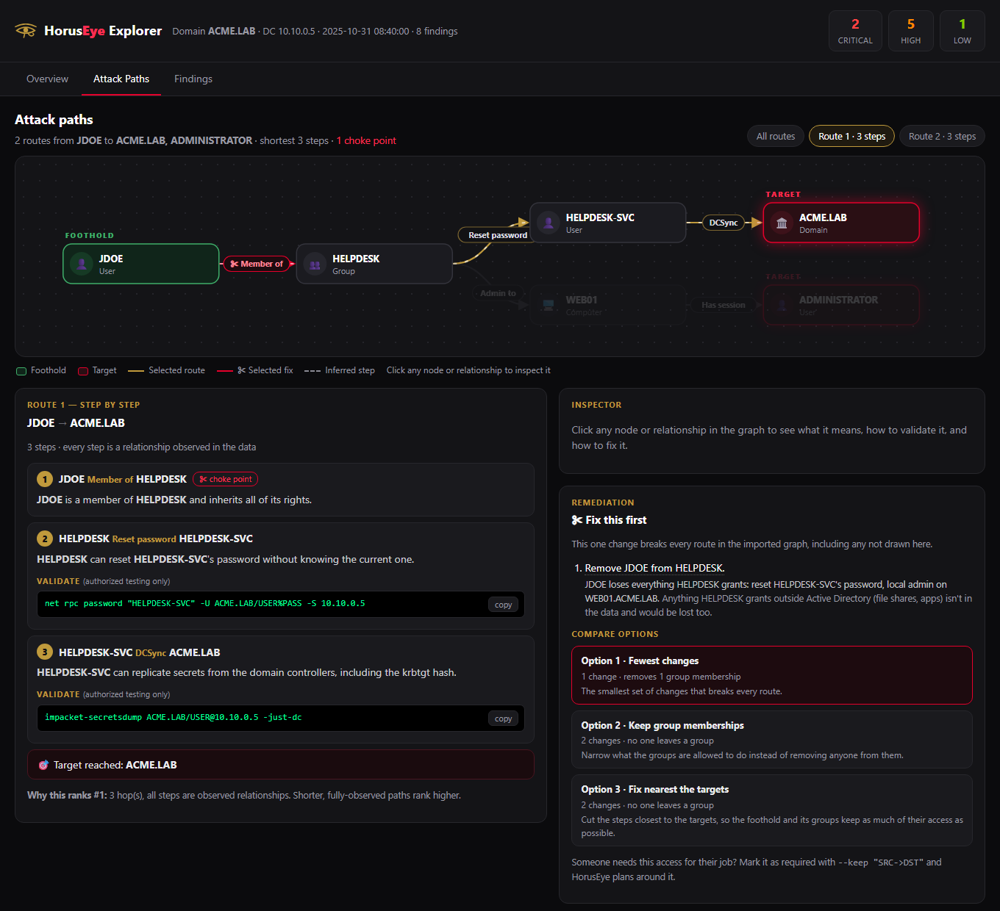
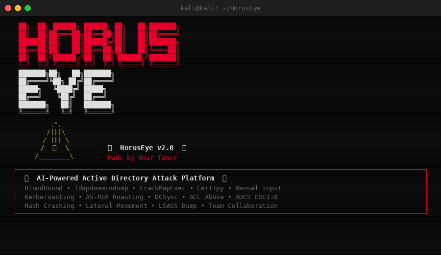
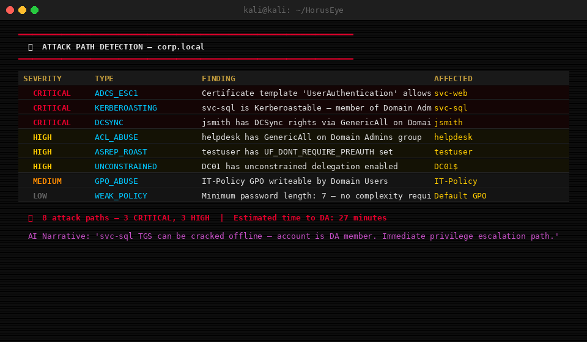
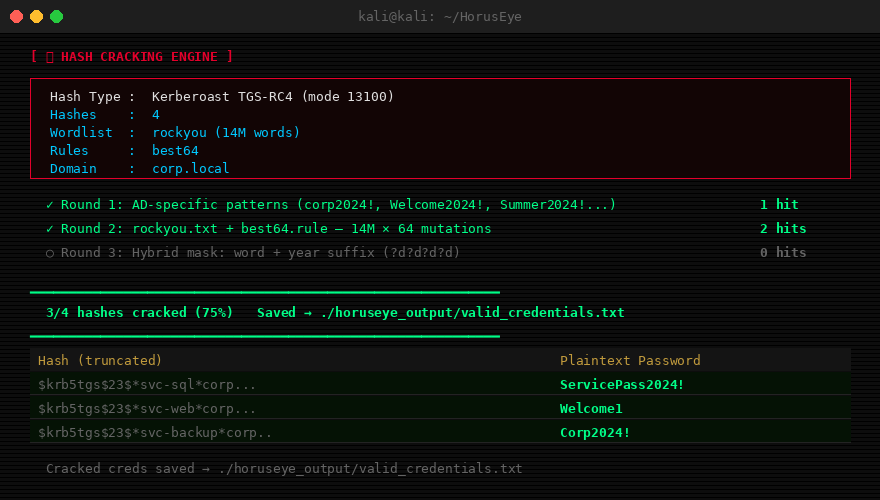
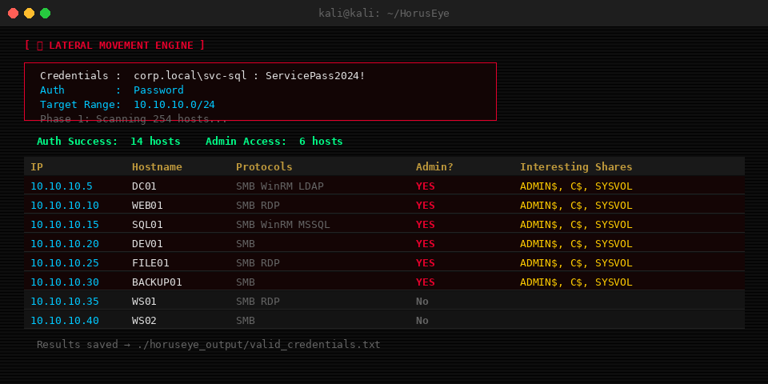
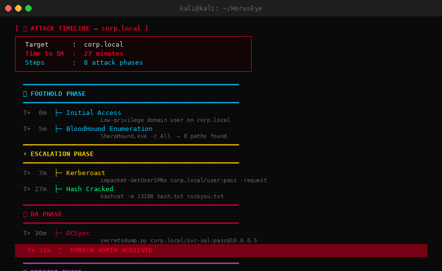
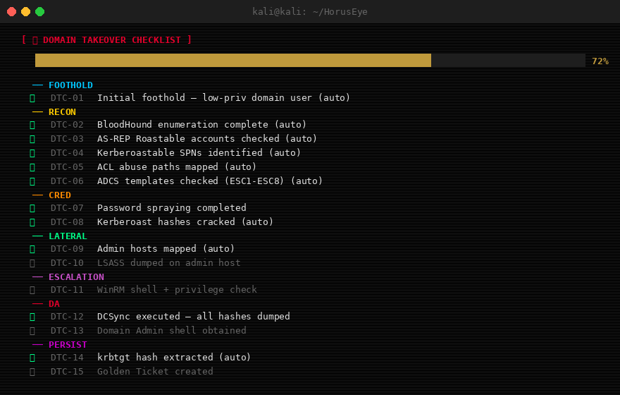
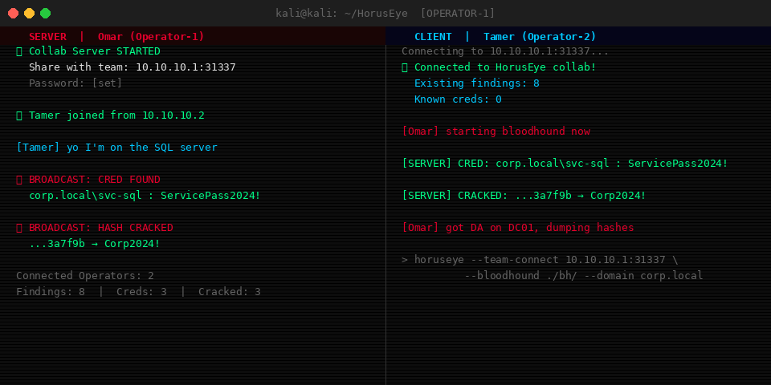
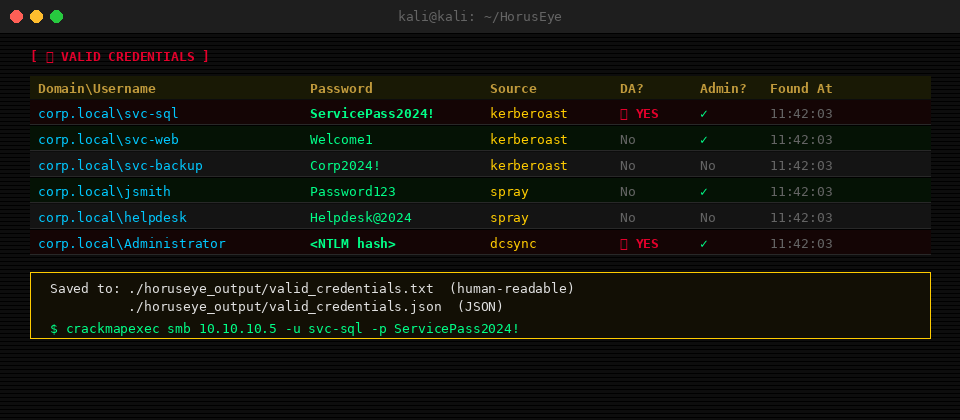

<div align="center">

# HorusEye

**Find the fix that breaks the most routes to Domain Admin.**

Maps Active Directory attack paths with evidence, compares remediation options side by side,
and produces an offline report for red and blue teams. Complements BloodHound.


**[▶ Live demo](https://omar-tamerr.github.io/HorusEye/demo.html)** · [Website](https://omar-tamerr.github.io/HorusEye/) · [Quick start](#quick-start) · [Changelog](CHANGELOG.md)



*Made with care by **Omar Tamer** — Egypt*

</div>

---

## What It Does

Point HorusEye at the data you already collect (a SharpHound/BloodHound export,
plus optional Certipy, ldapdomaindump and NetExec output) and it answers three
questions:

1. **How does an attacker reach Domain Admin from here?** It builds a control
   graph and finds the shortest routes from a foothold to Tier-0, with the
   evidence behind every step and whether that step is observed in the data or
   only inferred.
2. **Is there one fix that breaks them all?** It names the **choke points**:
   single relationships whose removal breaks every route in the imported graph.
3. **Which fix should we actually make?** It compares **remediation options**
   side by side (fewest changes, keep group memberships, fix nearest the
   targets) and shows who loses what access with each. Mark access people need
   for their job with `--keep`, and it is never proposed.

Everything lands in one offline report: the interactive explorer above, plus
HTML, Markdown and JSON. Nothing leaves the machine unless you turn on the
optional AI narrative layer (which can redact names first).

Alongside the paths, HorusEye flags **13 classes of AD misconfiguration**
(Kerberoasting, AS-REP roasting, DCSync, ACL abuse, GPO abuse, unconstrained and
constrained delegation, ADCS ESC1–ESC8, trusts, privileged sessions, weak
password policy and stale admins), each with evidence, a confidence level, MITRE
ATT&CK mapping, remediation steps and detection guidance.

**How it fits with BloodHound:** BloodHound collects and explores the graph.
HorusEye works on the same export and turns it into an ordered, evidence-backed
fix list you can hand to the team that owns the change.

---

## Quick Start

```bash
git clone https://github.com/Omar-tamerr/HorusEye && cd HorusEye
pip install -e .

# The bundled synthetic lab: 2 routes to Domain Admin, 1 choke point
horuseye --bloodhound examples/acme-lab --domain ACME.LAB --dc 10.10.0.5 \
    --graph --owned 'JDOE@ACME.LAB' --explorer acme.html

# JDOE needs HELPDESK for their job? Plan the fix around it
horuseye --bloodhound examples/acme-lab --domain ACME.LAB --dc 10.10.0.5 \
    --graph --owned 'JDOE@ACME.LAB' --keep 'JDOE@ACME.LAB->HELPDESK@ACME.LAB'

# Your own SharpHound export: paths from a user, reports, and a CI gate
horuseye --bloodhound ./bh/ --domain corp.local --dc 10.10.10.5 \
    --graph --owned 'bob@corp.local' \
    --explorer report.html --json report.json --fail-on high
```

Open `acme.html` in any browser, or try the
[live demo](https://omar-tamerr.github.io/HorusEye/demo.html) without
installing anything. Full details: [Installation](#installation),
[Attack Paths](#attack-paths), [More Examples](#more-examples).

---

## What's New in v2.3

**New on `main` (next release):** remediation options compared side by side, with who loses what access and `--keep` for access people need; and a redesigned attack-path view in the explorer. See [Attack Paths](#attack-paths).

- **Interactive offline explorer (`--explorer`).** One self-contained HTML file — a dashboard, a clickable attack-path graph (nodes/edges → evidence, choke points highlighted red), and a filterable findings explorer. No server, no external requests; open it anywhere, hand it to a client.
- **Evidence & confidence on every finding.** Each finding now carries a `rule_id`, a `confidence` level with a stated reason, and structured **evidence** — the actual ACEs/objects behind it — so it can be reproduced from source data. Aggregated findings keep every affected object; nothing is lost to brevity.
- **Provenance.** Findings trace to their exact **source file** (e.g. `corp_domains.json`), and a **parse report** with compatibility warnings distinguishes a clean domain from a thin import.
- **Graph you can trust and steer.** `--target` paths to any critical asset (not just Tier-0); edges are labelled **observed vs inferred**; paths rank with a stated rationale; and **remediation impact** names the choke points — the single fixes that break the path.
- **Automation-grade output.** Reports are **byte-deterministic** (`SOURCE_DATE_EPOCH`), and a documented **exit-code taxonomy** (0/1/2/3) lets CI tell "clean" from "findings" from "incomplete".
- **Privacy & AI safety.** `--ai-redact` masks emails, IPs, domain and account names before any request; AI output is validated and can never overwrite a verified field.
- **Honest UX.** The no-input help now describes the real CLI (the old phase-command help was misleading), and `SECURITY.md` documents intended use, data egress, and reporting.

<details><summary><b>What was new in v2.2</b></summary>

- **Attack-path graph engine (`--graph`).** HorusEye now builds a directed *control* graph from group membership, abusable ACLs, local-admin rights, sessions, DCSync and delegation, and finds the **shortest path from a foothold to Domain Admin** — printing the ordered steps and the command for each. BloodHound shows the graph; HorusEye tells you the order to walk it. Set the foothold with `--owned USER@DOMAIN` (default: any domain user).
- **Built for defenders too.** Every finding now carries **MITRE ATT&CK** technique(s), **remediation** steps, and **detection** guidance (event IDs / telemetry), so one report is actionable for red *and* blue teams.
- **Trustworthy on real exports.** Noise reduction drops expected rights (Domain Admins' GenericAll, DCs replicating), collapses duplicate ACEs, and aggregates mass grants — so a real SharpHound export produces a readable finding list, not thousands of rows.
- **Professional reports.** Reworked dark-theme **HTML** (severity tiles, ATT&CK table, per-finding remediation/detection), a new **Markdown** export (`--markdown`) with Mermaid attack-path diagrams, and a versioned **JSON** schema.
- **Repeatable workflow.** `--diff OLD.json` shows New / Fixed / Unchanged against a previous run; `--fail-on LEVEL` exits non-zero for CI gating.
- **Modernized AI layer.** Official Anthropic SDK, current model (`claude-opus-5-5`), per-finding narratives, surfaced errors, and `--ai-redact` to mask client names before anything leaves the machine.

<details><summary><b>What was new in v2.1</b></summary>

- All 13 attack-path types implemented (v2.0 shipped only Kerberoasting and AS-REP roasting).
- Impact-aware scoring with a Tier-0 privilege model; CRITICAL made reachable.
- Fixed the Windows `UnicodeEncodeError` crash; UTF-8 everywhere.
- Installable `horuseye` command (`pip install -e .`); `--check-deps` preflight.
- Honest `--da-checklist` and `--team-connect`; pytest suite + CI.
</details>

</details>

See the [full changelog](CHANGELOG.md) and the [Roadmap](#roadmap).

---

## Contents

- [What It Does](#what-it-does) · [Quick Start](#quick-start) · [What's New](#whats-new-in-v23)
- [Features](#features) · [Installation](#installation) · [Input Sources](#input-sources)
- [Attack Detection](#attack-detection) · [Attack Paths & Remediation Options](#attack-paths)
- [Reports](#reports) · [AI Analysis](#ai-analysis) · [More Examples](#more-examples)
- [Full CLI Reference](#full-cli-reference) · [Project Structure](#project-structure) · [Testing](#testing) · [Roadmap](#roadmap)
- [Offensive Helpers (Labs & CTF)](#offensive-helpers-labs--ctf): hash cracking, wordlists,
  password spraying, lateral movement, timeline, auto-exploit, LSASS, DA checklist,
  team collaboration, credentials manager, [CTF usage guide](#ctf-usage-guide)

---

## Features

| Category | Feature | Description |
|---|---|---|
| **Input** | BloodHound | Parses SharpHound JSON — users, groups, ACLs, sessions, local admins |
| **Input** | Certipy / ldapdomaindump / NetExec / CME | ADCS (ESC1–ESC8), LDAP and scan output |
| **Input** | Manual | Interactive prompt when no files are available |
| **Analysis** | Attack-path graph | Shortest routes from a foothold to Tier-0 or any `--target`, observed vs inferred steps |
| **Analysis** | 13 detections | Evidence, confidence, MITRE ATT&CK, remediation and detection guidance per finding |
| **Analysis** | Scoring | Ranks findings by impact × ease with a Tier-0 privilege model |
| **Remediation** | Choke points | The single relationships whose removal breaks every route in the imported graph |
| **Remediation** | Fix options | Alternatives compared side by side, with who loses what access; `--keep` for required access |
| **Reporting** | Explorer | One offline HTML file: dashboard, interactive graph, fix options, findings |
| **Reporting** | HTML / Markdown / JSON | Dark-theme report, Mermaid diagrams, versioned JSON schema |
| **Reporting** | Retest & CI | `--diff` (new / fixed / unchanged), `--fail-on`, deterministic output, exit codes |
| **AI** | Narratives (optional) | Plain-English explanation per finding; `--ai-redact` masks names first |
| **Labs** | [Offensive helpers](#offensive-helpers-labs--ctf) | Hash cracking, wordlists, spraying, lateral movement — some still stubs |

---

## Installation

**Requirements:** Python 3.8+ (Linux or Windows). The only Python dependency is
[`rich`](https://github.com/Textualize/rich); everything else is an *external
CLI tool* HorusEye orchestrates rather than a library it imports.

```bash
git clone https://github.com/Omar-tamerr/HorusEye
cd HorusEye

# Option A — install as a command (recommended)
pip install -e .          # adds the `horuseye` command to your PATH

# Option B — run in place
pip install -r requirements.txt
python3 horuseye.py --help
```

> On Kali/Debian with an externally-managed Python, add `--break-system-packages`
> to the `pip` call, or install into a virtualenv / via `pipx`.

**External toolchain (optional — only for the offense features).** Detection and
scoring work with no external tools at all. The modules that *execute* against a
DC shell out to the standard suite:

```bash
# check what is already on your PATH, grouped by the feature that needs it
horuseye --check-deps
```

| Feature | Tools |
|---|---|
| Hash cracking | `hashcat`, `john` |
| Enumeration / lateral | `nxc` (NetExec), `crackmapexec`, `evil-winrm` |
| Impacket suite | `impacket-GetUserSPNs`, `impacket-GetNPUsers`, `impacket-secretsdump` |
| ADCS | `certipy` |
| Collection | `bloodhound-python` |
| Credential parsing | `pypykatz` |

**Optional — AI narratives:**
```bash
horuseye --config --claude-key YOUR_ANTHROPIC_KEY   # stored in ~/.horuseye/config.json
```

---

## Input Sources



HorusEye accepts output from four major AD enumeration tools, or manual input when you only have partial information.

**BloodHound (recommended)**
```bash
# Collect with SharpHound on Windows target
SharpHound.exe -c All --zipfilename bloodhound.zip

# Or from Linux with bloodhound-python
bloodhound-python -d corp.local -u user -p pass -ns 10.10.10.5 -c All

# Feed to HorusEye
python3 horuseye.py --bloodhound ./bloodhound_output/
```

**Certipy (ADCS)**
```bash
certipy find -u user@corp.local -p pass -dc-ip 10.10.10.5 -json
python3 horuseye.py --certipy ./certipy_output.json
```

**ldapdomaindump**
```bash
ldapdomaindump -u 'corp\user' -p pass ldap://10.10.10.5 -o ./ldap/
python3 horuseye.py --ldap ./ldap/
```

**CrackMapExec**
```bash
cme smb 10.10.10.0/24 -u user -p pass --shares > cme_output.txt
python3 horuseye.py --cme cme_output.txt
```

**NetExec (recommended over CME)**
```bash
nxc smb 10.10.10.0/24 -u user -p pass --shares 2>&1 | tee nxc.txt
python3 horuseye.py --nxc nxc.txt --domain corp.local --dc 10.10.10.5
```

**Combined (best results)**
```bash
python3 horuseye.py \
    --bloodhound ./bh/ \
    --certipy certipy.json \
    --ldap ./ldap/ \
    --cme cme.txt \
	--nxc nxc.txt \
    --domain corp.local \
    --dc 10.10.10.5
```

---

## Attack Detection



HorusEye detects **all 13 attack path types** below (all implemented — see the [changelog](CHANGELOG.md)). Each finding includes a severity, the affected account/object, a standard documented command to validate it, a short rationale, and — with a key configured — an AI-generated attack narrative.

| # | Attack Type | Severity | What it detects |
|---|---|---|---|
| 1 | **Kerberoasting** | HIGH / CRITICAL | Service accounts with SPNs; Tier-0 members promoted to CRITICAL |
| 2 | **AS-REP Roasting** | HIGH / CRITICAL | Accounts with `DONT_REQUIRE_PREAUTH`; Tier-0 promoted |
| 3 | **DCSync** | CRITICAL | Principals with replication rights (GetChanges / GetChangesAll) |
| 4 | **ACL Abuse** | HIGH / CRITICAL | GenericAll, GenericWrite, WriteDacl, WriteOwner, ForceChangePassword, AddMember, AddKeyCredentialLink, WriteSPN |
| 5 | **GPO Abuse** | HIGH | Write access on Group Policy Objects |
| 6 | **Unconstrained Delegation** | CRITICAL | Computers/users trusted for unconstrained delegation |
| 7 | **Constrained Delegation** | HIGH | Protocol-transition (`TrustedToAuthForDelegation`) misconfigurations |
| 8 | **Pass-the-Hash** | HIGH | Reusable admin access across multiple hosts |
| 9 | **ADCS ESC1-ESC8** | CRITICAL / HIGH | All Certipy ADCS vulnerability classes |
| 10 | **Domain Trusts** | MEDIUM / HIGH | Cross-domain / forest trust relationships |
| 11 | **Privileged Sessions** | HIGH | Tier-0 sessions on reachable hosts |
| 12 | **Weak Password Policy** | MEDIUM | Lockout threshold, minimum length, complexity |
| 13 | **Stale Admin Accounts** | LOW / MEDIUM | Disabled-but-privileged and password-never-expires admins |

Findings are scored **0–100**, combining severity with an exploitability-ease factor, and sorted so the shortest path to Domain Admin surfaces first (a one-command DCSync outranks a crack-then-pivot chain). The **Tier-0 privilege model** — built from `adminCount` and well-known group membership — promotes any path that lands directly on a Domain/Enterprise Admin to CRITICAL.

> **Scope note.** Detection reports *where* a misconfiguration exists and the standard, publicly documented command to validate it. The offensive execution engines (`--auto-exploit`, `--auto-chain`, `--lsass-dump`) are stubs — they print the method rather than executing it — and are tracked on the [Roadmap](#roadmap). Detection itself requires none of the external tools.

---

## Attack Paths

`--graph` is the difference between a list of problems and a plan. HorusEye builds a directed **control graph** — where an edge `A → B` means "control of A yields control of B" — from group membership, abusable ACLs, local-admin rights (`AdminTo`), sessions (`HasSession`), DCSync rights, and delegation, then finds the **shortest route from a foothold to Domain Admin** and prints the ordered steps with the command for each.

```bash
# What can a given user reach?
horuseye --bloodhound ./bh/ --domain corp.local --dc 10.10.10.5 --graph --owned 'bob@corp.local'

# What can ANY domain user reach? (default start = broad groups)
horuseye --bloodhound ./bh/ --domain corp.local --graph
```

```
Path 1  (3 hops: BOB@CORP.LOCAL → SVC-ADM@CORP.LOCAL)
  BOB@CORP.LOCAL
    │ MemberOf (member of group)
    ▼ HELPDESK@CORP.LOCAL
    │ AdminTo (local administrator)
    ▼ WS01.CORP.LOCAL     nxc smb WS01 -u USER -p PASS --sam
    │ HasSession (credentials in memory)
    ▼ SVC-ADM@CORP.LOCAL  # dump LSASS on WS01 to recover SVC-ADM
```

Paths are included in the HTML report and rendered as Mermaid diagrams in the Markdown export. Richer paths need local-admin and session data — collect with `SharpHound.exe -c All`.

### Remediation options — fix it without breaking someone's job

The shortest fix is not always the right one. Removing a user from a group closes the routes, but it also takes away everything that group gives them, including access their job depends on. So after the paths, HorusEye compares **remediation options**. Each one is a different set of changes that **breaks every route in the imported graph**, including routes not shown, and is re-checked by search before it is reported. That is the scope of the check: relationships missing from the collected data can't be seen.

| Option | What it does |
|---|---|
| **Fewest changes** | The smallest set of changes that breaks every route |
| **Keep group memberships** | Nobody is removed from a group; the groups' own permissions are narrowed instead |
| **Fix nearest the targets** | Cuts the steps closest to the targets, so the foothold keeps as much access as possible |

Every change says **who is affected and what they lose**: a removed membership lists every right the user loses with it (and warns that access granted outside AD, like file shares and apps, isn't in the data); a narrowed group permission lists every member who loses that one right.

HorusEye can't know what someone needs for their job, so you tell it. Mark required access with `--keep`, and no option will ever remove it:

```bash
# The bundled example: JDOE needs to stay in HELPDESK
horuseye --bloodhound examples/acme-lab --domain ACME.LAB --dc 10.10.0.5 --graph \
    --owned 'JDOE@ACME.LAB' --keep 'JDOE@ACME.LAB->HELPDESK@ACME.LAB'
```

```
𓂀 Remediation options (each breaks every route in the imported graph, including routes not shown)
Option 1 · Fewest changes  2 changes · no one leaves a group
  ✂ Remove the password-reset right HELPDESK holds on HELPDESK-SVC.
    HELPDESK's 2 members (HELPDESK-SVC, JDOE) lose only this right: reset HELPDESK-SVC's password.
  ✂ Remove HELPDESK from the local Administrators group on WEB01.ACME.LAB (use Windows LAPS for local admin).
    HELPDESK's 2 members (HELPDESK-SVC, JDOE) lose only this right: local admin on WEB01.ACME.LAB.
Option 2 · Fix nearest the targets  2 changes · no one leaves a group
  ✂ Remove HELPDESK from the local Administrators group on WEB01.ACME.LAB (use Windows LAPS for local admin).
    HELPDESK's 2 members (HELPDESK-SVC, JDOE) lose only this right: local admin on WEB01.ACME.LAB.
  ✂ Remove replication rights (Get-Changes / Get-Changes-All) from HELPDESK-SVC.
    HELPDESK-SVC loses only this right: replicate domain secrets (DCSync).
```

Without `--keep`, option 1 is "Remove JDOE from HELPDESK" (one change), and the report spells out that JDOE would lose the password-reset right and local admin on WEB01 along with it.

The options are in the explorer (pick one and the ✂ marks move on the graph), the HTML and Markdown reports, and the JSON (`remediation_plans`).

| Flag | Purpose |
|---|---|
| `--graph` | Compute and print the shortest attack path(s) to Domain Admin |
| `--owned PRINCIPALS` | Comma-separated foothold principals (default: any domain user) |
| `--max-paths N` | Maximum node-diverse paths to show (default: 5) |
| `--keep 'SRC->DST'` | Access people need for their job; remediation options never remove it (repeatable or comma-separated) |

---

## Reports

```bash
# HTML report (dark theme, all findings + commands)
python3 horuseye.py --bloodhound ./bh/ --domain corp.local --report report.html

# JSON export
python3 horuseye.py --bloodhound ./bh/ --domain corp.local --json findings.json

# Filter by severity
python3 horuseye.py --bloodhound ./bh/ --domain corp.local --severity critical
python3 horuseye.py --bloodhound ./bh/ --domain corp.local --severity high
```

---

## AI Analysis

HorusEye uses Claude (Anthropic) to provide:
- Plain-English explanation of each finding
- Attack chain narrative ("svc-sql TGS can be cracked offline — account is DA member. Kerberoast → crack → DCSync is the fastest path")
- Impact assessment
- Prioritization reasoning

```bash
# Set API key
python3 horuseye.py --config --claude-key YOUR_KEY

# Deep analysis mode (more detailed narratives)
python3 horuseye.py --bloodhound ./bh/ --domain corp.local --deep

# Skip AI (rules-only mode, faster)
python3 horuseye.py --bloodhound ./bh/ --domain corp.local --no-ai
```

AI analysis is optional. All detection, scoring, graphing, and reporting work without an API key.

**What is sent, and when.** AI runs only when a key is configured and `--no-ai` is not set. One request is made per run, containing a compact list of findings (id, severity, type, and the affected principal) for the top 10 (or 20 with `--deep`) — never raw credentials, hashes, or file contents. The model may only populate each finding's `ai_narrative`; its output is validated (correct id, string, length-capped) and can never overwrite a verified field (severity, evidence, remediation, commands).

**Keeping client data local (`--ai-redact`).** With this flag, every sensitive identifier — email addresses, IPv4 addresses, the domain, and all principal/computer/host names — is replaced with a stable placeholder *before* the request leaves the machine, and restored in the returned narrative locally. Use it on engagements where client names must not reach a third-party API.

```bash
horuseye --bloodhound ./bh/ --domain corp.local --deep --ai-redact
```

---

## More Examples

```bash
# Analyze BloodHound + Certipy output
horuseye --bloodhound ./bloodhound/ --certipy certipy.json \
    --domain corp.local --dc 10.10.10.5

# Paths to a specific critical asset instead of Tier-0
horuseye --bloodhound ./bh/ --domain corp.local --dc 10.10.10.5 --graph \
    --owned 'bob@corp.local' --target 'SQL01.CORP.LOCAL'

# Retest: what is new, fixed or unchanged since the last report
horuseye --bloodhound ./bh-retest/ --domain corp.local --dc 10.10.10.5 \
    --json retest.json --diff report.json

# No files yet? Use manual input
horuseye --manual --domain corp.local --dc 10.10.10.5
```

Lab and CTF workflows (spraying, cracking, lateral movement) are in the
[CTF usage guide](#ctf-usage-guide).

---

## Full CLI Reference

```
AD Input Sources:
  --bloodhound DIR      BloodHound JSON folder (SharpHound output)
  --ldap DIR            ldapdomaindump output folder
  --cme FILE            CrackMapExec output file
  --nxc FILE            NetExec (nxc) output — modern CrackMapExec replacement
  --certipy FILE        Certipy JSON output
  --manual              Interactive manual input mode

Target:
  --domain DOMAIN       Target domain (e.g. corp.local)
  --dc IP               Domain Controller IP

Automation:
  --interactive         AI-guided interactive mode (confirm each step)
  --auto-exploit        Auto-exploit best path to Domain Admin
  --auto-pivot          Re-enumerate after new credentials found
  --auto-persist        Suggest persistence after DA achieved
  --auto-chain          Kerberoast → crack → validate → pivot chain
  --timeline            Visual attack timeline T+0 to DA
  --da-checklist        20-item domain takeover checklist (auto-ticked from findings)

Exploitation:
  --winrm HOST          WinRM connect + privilege analysis
  --lsass-dump HOST     AV-aware LSASS dump (auto-selects method)
  --pivot               Lateral movement network mapping
  --target-network CIDR Network range for pivot scan
  -u, --username USER   Username for authentication
  -p, --password PASS   Password for authentication
  -H, --hash HASH       NTLM hash (Pass-the-Hash)

Hash Cracking:
  --crack FILE          Crack hashes from file
  --hash-type TYPE      kerberoast | asrep | ntlm | ntlmv2 | mscache2
  --wordlist FILE       Wordlist path or name (rockyou, fasttrack, ...)
  --rules PROFILE       fast | medium | aggressive | corporate
  --crack-timeout INT   Max seconds per hashcat round (default: 300)

Wordlist + Spray:
  --make-wordlist       Generate username wordlist
  --users-file FILE     Input users/names file
  --firstname NAME      Single first name
  --lastname NAME       Single last name
  --output FILE         Output file (default: usernames.txt)
  --spray               Run password spraying
  --password PASS       Single password to spray
  --passwords-file FILE Multiple passwords to spray
  --delay FLOAT         Delay between attempts (default: 1.0s)
  --jitter FLOAT        Random jitter added to delay (default: 0.5s)
  --threads INT         Concurrent threads (default: 5)
  --safe                Stop automatically on lockout detection

Team Collaboration:
  --team-server         Start collaboration server
  --team-connect HOST   Connect to existing session (HOST:PORT)
  --team-port INT       Port for collaboration server (default: 31337)

Attack Paths:
  --graph               Compute shortest attack path(s) to Domain Admin
  --owned PRINCIPALS    Comma-separated owned principals (default: any user)
  --target ASSETS       Critical assets to path to (default: Tier-0)
  --max-paths N         Max attack paths to show (default: 5)
  --keep 'SRC->DST'     Required access remediation options must not remove

AI + Output:
  --claude-key KEY      Anthropic API key
  --no-ai               Skip Claude AI analysis
  --deep                Deeper AI analysis (higher reasoning effort)
  --ai-model MODEL      Claude model for narratives (default: claude-opus-5-5)
  --ai-redact           Mask domain/principal names before sending to the API
  --report FILE         Export HTML report
  --markdown FILE       Export Markdown report (Mermaid attack-path diagrams)
  --explorer FILE       Interactive offline HTML explorer (dashboard+graph+findings)
  --json FILE           Export JSON findings (schema horuseye.report/2)
  --diff OLD.json       Retest: compare to a previous JSON report
  --fail-on LEVEL       Exit non-zero if a finding at/above LEVEL exists (CI)
  --severity LEVEL      Filter: critical | high | all
  --config              Configure persistent settings
  --check-deps          Report which external tools are on PATH
```

---

## Project Structure

HorusEye is a single installable package. The feature areas map directly to the
attack lifecycle, so the code reads the way an engagement runs:

```
horuseye/
├── cli.py            # argument parsing + orchestration (entry point)
├── parsers/          # ingest BloodHound, ldapdomaindump, CME, NetExec, Certipy
├── core/             # the analysis brain:
│   ├── attack_detector.py   # the 13 detections
│   ├── path_scorer.py       # exploitability scoring
│   ├── principals.py        # Tier-0 / noise / broad principal model
│   ├── knowledge.py         # ATT&CK + remediation + detection per finding
│   ├── graph.py             # attack-path graph → shortest route to DA
│   ├── diff.py              # retest diff + CI fail-gate
│   ├── finding.py           # finding schema (evidence, confidence, rule_id)
│   └── exit_codes.py        # automation exit-code taxonomy
├── engine/           # hash cracking, lateral movement, timeline, checklist, ...
├── features/         # creds manager, password spray, wordlist gen, team collab
├── reports/          # CLI / HTML / Markdown / JSON report generation
├── ai/               # optional Claude layer + local redaction (horuseye[ai])
└── utils/            # config, dependency preflight, help
tests/                # pytest suite — 137 tests (parsers, detector, graph,
                      #   knowledge, noise, reports, diff, AI, schema,
                      #   provenance, determinism, redaction)
docs/                 # screenshots and reference material
```

Run it with the installed `horuseye` command, with `python -m horuseye`, or
straight from a clone with `python horuseye.py`.

**Try it now** on the synthetic [`examples/acme-lab`](examples/README.md) dataset
(no collection needed). **Embed it** via the stable Python API:

```python
from horuseye import api
data = api.parse_sources(bloodhound="./bh/", domain="corp.local", dc="10.0.0.5")
result = api.analyze(data, owned=["bob@corp.local"])   # findings + paths + summary
```

See [docs/ARCHITECTURE.md](docs/ARCHITECTURE.md) for the design and
[CONTRIBUTING.md](CONTRIBUTING.md) to add a detection.

---

## Testing

```bash
pip install -e ".[dev]"   # installs pytest
pytest -q
```

137 tests cover the BloodHound parser, the scorer, the full detection engine,
noise reduction, the knowledge base, the attack-path graph and remediation
options, report exports, the
retest diff, and the AI layer (with a fake SDK — no network). A regression guard
fails if the detector ever stops emitting any of the 13 types or stops producing
CRITICAL findings. CI runs the suite plus a `--help` / `--check-deps` smoke test
on Linux and Windows (the Windows job guards the console-encoding fix).

---

## Roadmap

HorusEye is an **analysis** platform: it detects and ranks paths and hands
you the validated command for each. The following are tracked for future
releases:

- **Offensive execution engines.** `--auto-exploit`, `--auto-chain` and
  `--lsass-dump` currently print the method rather than executing it. Wiring
  them to live execution is a deliberate, opt-in capability change rather than
  silent behaviour.
- **AI chain-ordering.** Extend the narrative layer (shipped on the current
  model in v2.2) from per-finding narratives to full attack-chain reasoning
  over the computed graph paths.
- **Graph coverage.** Add ADCS and shadow-credential edges to the attack-path
  graph, and weighted paths (by exploitation ease, not just hop count).

*Shipped in v2.2: the attack-path graph engine, the defender-facing knowledge
base, and the modernized AI layer. Shipped in v2.3: the finding evidence/
confidence schema, parser provenance, graph trust + remediation impact,
deterministic output + CI exit codes, redaction hardening, benchmarks, a public
Python API, and the interactive offline explorer.*

Contributions and issues are welcome at the
[issue tracker](https://github.com/Omar-tamerr/HorusEye/issues).

---

## Offensive Helpers (Labs & CTF)

HorusEye started as a CTF tool, and these helpers remain for lab work and
authorized engagements. Nothing in the attack-path, remediation or reporting
features above depends on them. Some are stubs that print the method and
commands instead of executing them; each section says so.

### Hash Cracking Engine



Three-round cracking strategy designed for Active Directory environments. All cracked credentials are automatically appended to `valid_credentials.txt`.

**Round 1 — AD-specific patterns** (runs first, fastest)
Generates 230+ corporate password candidates including company name, current/previous year, and season combinations:
`Corp2024!`, `Welcome2024!`, `Summer2024!`, `Password2024!`, `Corp@2025`, etc.

**Round 2 — Wordlist + rules**
Runs rockyou.txt (or any wordlist) through hashcat rule mutations. Default: `best64` (64 common transforms). Options: `dive`, `d3ad0ne`, `rockyou-30000`.

**Round 3 — Hybrid mask** (small hash sets only)
Appends year/number suffixes to wordlist words: `word + ?d?d?d?d`, `word + !year`.

**Supported hash types:**

| Flag | Type | Hashcat Mode |
|---|---|---|
| `kerberoast` | Kerberoast TGS-RC4 | 13100 |
| `asrep` | AS-REP Roast | 18200 |
| `ntlm` | NTLM | 1000 |
| `ntlmv2` | NetNTLMv2 | 5600 |
| `mscache2` | MS-Cache v2 (DCC2) | 2100 |

```bash
# Crack a file of Kerberoast hashes
python3 horuseye.py --crack hashes.txt --hash-type kerberoast

# Crack NTLM hashes with aggressive rules
python3 horuseye.py --crack ntlm.txt --hash-type ntlm --rules aggressive

# Show available wordlists and rules
python3 -c "from hash_cracker import HashCrackingEngine; e=HashCrackingEngine(); e.show_wordlists(); e.show_rules()"

# AS-REP roast + crack inline
python3 horuseye.py --bloodhound ./bh/ --domain corp.local --dc 10.10.10.5 --auto-chain
```

Hash type is auto-detected if not specified. Cracked hashes are written immediately to `./horuseye_output/valid_credentials.txt`.

### Username Wordlist Generator

Generates username variants from real AD users or a names list. 18 format patterns per name.

**Generated formats for `John Smith`:**

| Format | Example |
|---|---|
| `first.last` | `john.smith` |
| `flast` | `jsmith` |
| `f.last` | `j.smith` |
| `lastf` | `smithj` |
| `first_last` | `john_smith` |
| `adm_flast` | `adm_jsmith` |
| `svc_flast` | `svc_jsmith` |
| `firstlast` | `johnsmith` |
| `FLAST` | `JSMITH` |
| `First.Last` | `John.Smith` |
| + 8 more... | |

```bash
# From BloodHound users (most accurate)
python3 horuseye.py --bloodhound ./bh/ --domain corp.local --make-wordlist --output users.txt

# From a names file
python3 horuseye.py --make-wordlist --users-file names.txt --output wordlist.txt

# Single name
python3 horuseye.py --make-wordlist --firstname John --lastname Smith --output john.txt
```

### Password Spraying

Multi-threaded password sprayer with lockout protection. Supports SMB (primary) and LDAP (fallback) authentication.

```bash
# Basic spray
python3 horuseye.py --spray --users-file users.txt --password 'Password123' \
    --domain corp.local --dc 10.10.10.5

# Safe mode: stops automatically if lockout detected
python3 horuseye.py --spray --users-file users.txt --password 'Summer2024!' \
    --domain corp.local --dc 10.10.10.5 --safe --delay 2.0 --jitter 0.5

# Multiple passwords from file
python3 horuseye.py --spray --users-file users.txt --passwords-file passes.txt \
    --domain corp.local --dc 10.10.10.5 --safe --threads 3
```

**Options:**

| Flag | Default | Description |
|---|---|---|
| `--safe` | off | Auto-stop on first lockout detected |
| `--delay` | 1.0s | Delay between each attempt |
| `--jitter` | 0.5s | Random jitter added to delay |
| `--threads` | 5 | Concurrent threads |

Valid credentials are saved to `valid_credentials.txt` immediately on discovery.

### Lateral Movement Engine



After obtaining credentials, maps every reachable host on the network. Multi-threaded port scan → credential test → admin detection → share enumeration.

```bash
python3 horuseye.py --pivot \
    --target-network 10.10.10.0/24 \
    -u svc-sql -p '<password>' \
    --domain corp.local --dc 10.10.10.5
```

**What it does:**
1. Port scans the target range for SMB (445), WinRM (5985), RDP (3389), LDAP (389), MSSQL (1433)
2. Tests credentials on every live SMB host
3. Probes `ADMIN$` share to confirm local admin rights
4. Enumerates accessible shares (flags SYSVOL, C$, backup, data)
5. Saves all admin hosts to `valid_credentials.txt` with format `ADMIN:IP:hostname:domain\user`

Outputs a table of reachable hosts with protocol icons, admin status, and next-step commands for each admin host.

### Attack Timeline



Builds a visual ASCII timeline from your current position to Domain Admin, with time estimates for each step.

```bash
python3 horuseye.py --bloodhound ./bh/ --domain corp.local --timeline
```

Phases: `FOOTHOLD` → `ESCALATION` → `LATERAL` → `DA` → `PERSIST`

Each step shows:
- Estimated elapsed time (T+Xm)
- Exact command to run
- AI narrative explaining the step
- Time estimate to crack (for Kerberoast/AS-REP)

Export to plain text for reports:
```bash
python3 -c "
from attack_timeline import AttackTimeline
tl = AttackTimeline()
tl.build_from_findings(findings, 'corp.local')
tl.export_timeline_txt('timeline.txt', 'corp.local')
"
```

### Auto-Exploit Chain

> **Status:** these flags are **stubs** — they print the chain/method and the
> commands to run rather than executing against a DC. Live execution is on the
> [Roadmap](#roadmap). The sections below describe the intended workflow.

Automated end-to-end exploitation without manual steps.

```bash
# Kerberoast → crack → validate → pivot
python3 horuseye.py --bloodhound ./bh/ --domain corp.local --dc 10.10.10.5 --auto-chain

# Full path to DA
python3 horuseye.py --bloodhound ./bh/ --domain corp.local --dc 10.10.10.5 --auto-exploit

# After DA: suggest and execute persistence
python3 horuseye.py --bloodhound ./bh/ --domain corp.local --dc 10.10.10.5 \
    --auto-exploit --auto-persist

# Interactive: AI asks before every action
python3 horuseye.py --bloodhound ./bh/ --domain corp.local --dc 10.10.10.5 --interactive
```

In `--interactive` mode, HorusEye acts as a senior red team operator. It presents ranked options at each decision point and waits for your confirmation before executing.

### LSASS Dump Automation

> **Status:** stub — prints the recommended dump method and commands rather
> than executing them. See the [Roadmap](#roadmap).

Selects an LSASS dump method based on the environment and prints the exact commands to run.

```bash
python3 horuseye.py --lsass-dump 10.10.10.10 \
    -u svc-sql -p '<password>' --domain corp.local
```

**Method selection logic:**

| Detected AV | Selected Method | Stealth Score |
|---|---|---|
| CrowdStrike / SentinelOne | nanodump | 10/10 |
| Windows Defender | comsvcs (rundll32) | 8/10 |
| None detected | comsvcs (rundll32) | 8/10 |
| Fallback | procdump | 5/10 |

After dumping, extract with:
```bash
pypykatz lsa minidump lsass.dmp
# or
mimikatz # sekurlsa::minidump lsass.dmp
mimikatz # sekurlsa::logonpasswords full
```

### Domain Takeover Checklist



20-item checklist covering every phase of a domain takeover. Items auto-tick from the live detection results of the current run (✅ when a matching finding was produced, ⬜ for manual steps not yet observed).

```bash
python3 horuseye.py --bloodhound ./bh/ --domain corp.local --da-checklist
```

Categories: FOOTHOLD → RECON → CRED → LATERAL → ESCALATION → DA → PERSIST → REPORT

Items marked `(auto)` are checked automatically when HorusEye detects or completes that step. Manual items require your confirmation.

### Team Collaboration



Real-time shared session over TCP port 31337. One operator hosts, others connect. All findings, cracked hashes, and credentials are broadcast to every connected operator instantly.

```bash
# Operator 1: start the server
python3 horuseye.py --team-server --team-port 31337

# Operator 2: join and run analysis simultaneously
python3 horuseye.py --team-connect 10.10.10.1:31337 \
    --bloodhound ./bh/ --domain corp.local --dc 10.10.10.5

# With password protection
python3 horuseye.py --team-server --team-port 31337
# set password in config, others pass it with --team-connect
```

What gets shared in real-time:
- New attack path findings
- Valid credentials discovered
- Cracked hashes
- Checklist item updates
- Chat messages between operators

Operators joining late receive a full state sync of everything found so far.

### Credentials Manager



Every credential found by any module (spray, kerberoast, AS-REP, crack, lateral movement, DCSync) is funnelled through a central manager with automatic deduplication.

**Output files:**

`valid_credentials.txt` — Human-readable, one credential per line:
```
corp.local\svc-sql:<password>  # kerberoast [2025-01-15 14:32:11]
corp.local\jsmith:<password>         # spray [2025-01-15 14:45:03]
corp.local\Administrator:<NTLM>      # dcsync [DA] [2025-01-15 15:01:44]
```

`valid_credentials.json` — Structured JSON for pipeline integration:
```json
{
  "credentials": [
    {
      "domain": "corp.local",
      "username": "svc-sql",
      "password": "<password>",
      "source": "kerberoast",
      "is_da": false,
      "is_admin": true
    }
  ]
}
```

```bash
# Quick use with impacket after HorusEye run
secretsdump.py corp.local/svc-sql:'<password>'@10.10.10.5
crackmapexec smb 10.10.10.0/24 -u svc-sql -p '<password>'
```

### CTF Usage Guide

For CTF players: run SharpHound, feed the output to HorusEye, and within seconds you have a ranked list of attack paths from your current user to Domain Admin, with the command to validate each step.

**HackTheBox Pro Labs / Active Directory machines**

```bash
# Step 1: Collect with SharpHound (run on Windows target)
SharpHound.exe -c All --zipfilename bh.zip
# Transfer to Kali and extract

# Step 2: ADCS enumeration (if CA present)
certipy find -u user@corp.local -p pass -dc-ip DC_IP -json

# Step 3: Run HorusEye
python3 horuseye.py \
    --bloodhound ./bh/ \
    --certipy certipy.json \
    --domain corp.local \
    --dc DC_IP \
    --timeline \
    --da-checklist \
    --report report.html

# Step 4: If Kerberoastable accounts found (stub: prints the chain to run)
python3 horuseye.py --auto-chain --domain corp.local --dc DC_IP \
    -u user -p pass

# Step 5: After creds, lateral movement
python3 horuseye.py --pivot --target-network 10.10.10.0/24 \
    -u svc-sql -p '<password>' --domain corp.local --dc DC_IP
```

**Common CTF scenarios HorusEye detects:**

- `ADCS ESC1` — Template allows SAN → request cert as DA → PKINIT → NTLM hash
- `Kerberoast → crack → ACL chain` — Service account with WriteDacl on Domain Admins
- `AS-REP Roast` — No credentials needed for initial foothold
- `Unconstrained delegation` — Trigger printerbug → capture DA TGT
- `Password spray → DA session on workstation` — Lateral to DA workstation → dump LSASS

---

## Legal Notice

This tool is intended for authorized penetration testing, CTF competitions, and security research only. Unauthorized use against systems you do not own or have explicit written permission to test is illegal. The author assumes no liability for misuse.

---

## Author

**Omar Tamer**

Penetration Tester — Egypt

[](https://www.linkedin.com/in/omar-tamer-1a986b2a7/)
[](https://medium.com/@OmarTamer0)
[](https://omar-tamerr.github.io/)

| | |
|---|---|
| LinkedIn | [linkedin.com/in/omar-tamer-1a986b2a7](https://www.linkedin.com/in/omar-tamer-1a986b2a7/) |
| Medium | [medium.com/@OmarTamer0](https://medium.com/@OmarTamer0) |
| Portfolio | [omar-tamerr.github.io](https://omar-tamerr.github.io/) |

> "The Eye of Horus sees all paths through the domain."

</div>

---

<div align="center">

*HorusEye v2.2 — Built for red teamers, by a red teamer*

</div>
